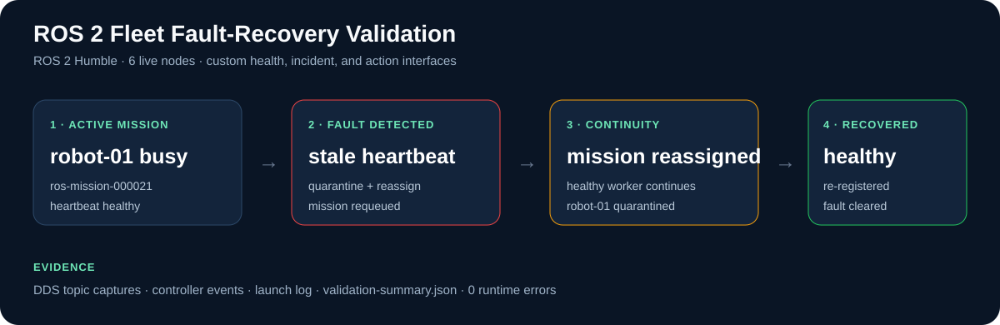
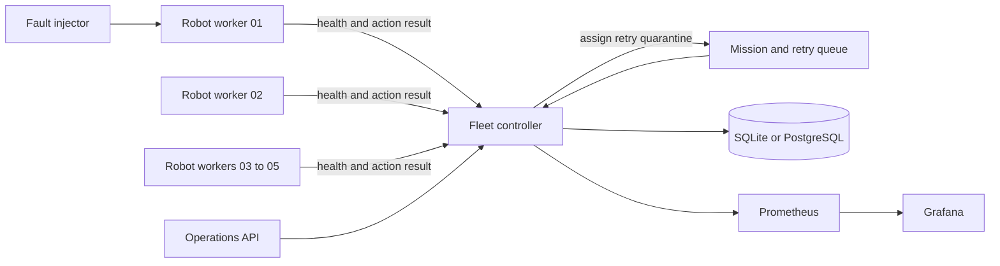
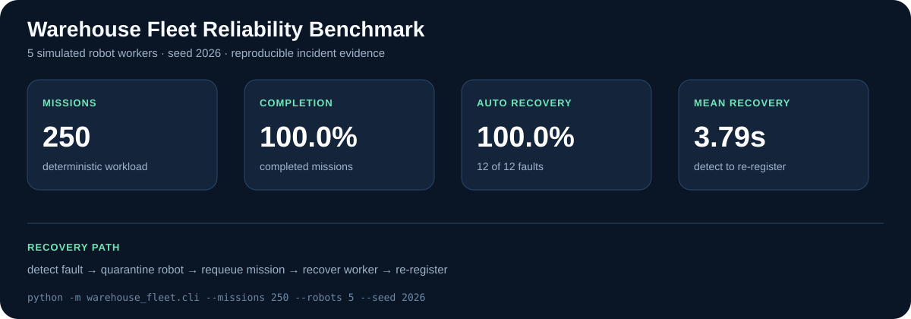

# ROS 2 Warehouse Fleet Reliability Lab

[](https://github.com/DEWARAJ/ros2-warehouse-fleet-reliability/actions/workflows/ci.yml)


A reproducible reliability and incident-response platform for a simulated warehouse robot fleet. Five ROS 2 workers execute pickup-style missions while a fleet controller monitors health, quarantines failed robots, reassigns interrupted work, restores recovered workers, and preserves operational evidence for analysis.

The project focuses on the work required to keep a robot fleet useful after deployment: failure detection, mission continuity, observability, SQL analysis, operator tooling, incident documentation, and repeatable validation.



## Results at a glance

| Validation | Result |
| --- | ---: |
| Live ROS 2 graph | 1 controller and 5 robot workers |
| Runtime fault scenario | stale heartbeat during an active mission |
| Recovery behavior | quarantine, requeue, reassignment, re-registration |
| Python tests | 11 passed |
| Runtime errors in validated ROS run | 0 |
| Controlled workload | 500 missions, 5 robots, identical seeded faults |
| Simulated availability | 66.94% to 99.04% with recovery enabled |
| Simulated throughput | 121.83 to 179.37 missions/minute |
| Workload duration | reduced 32.08% |

All performance and availability numbers are deterministic simulator results. The ROS 2 fault-recovery path was executed under ROS 2 Humble in WSL2. This repository does not claim a physical warehouse deployment or commercial uptime.

## Fault-recovery walkthrough

1. The controller assigns missions to five healthy workers.
2. The fault injector suppresses robot-01 heartbeats during an active mission.
3. The controller detects the stale heartbeat and quarantines robot-01.
4. The interrupted mission is requeued and assigned to a healthy worker.
5. Robot-01 clears the fault, reports healthy, and is admitted back into the fleet.
6. Health, incident, mission, and operator events remain available for replay and analysis.

The successful run is backed by committed topic captures, controller events, launch logs, and a machine-readable summary in [`results/ros2`](results/ros2/).

## System architecture



## Engineering features

### Fleet reliability

- heartbeat and odometry freshness monitoring
- capacity-aware mission assignment across a configurable fleet
- quarantine before recovery so unhealthy workers receive no new work
- interrupted-mission reassignment with bounded retries
- idempotent mission identifiers
- automatic recovery and fleet re-registration
- deterministic injection of eight failure modes

### Operations and observability

- Prometheus-format fleet and per-robot metrics
- Grafana dashboard provisioning
- live HTTP operations API
- operator-attributed fault and recovery commands
- SQLite evidence for local execution
- PostgreSQL schema and runtime adapter for deployment
- SQL for throughput, availability, failure rate, downtime, MTTR, p95 recovery, and unresolved incidents

### Validation and documentation

- custom ROS 2 health and incident messages
- action-based mission execution
- raw DDS topic and launch evidence
- deterministic comparison of recovery-disabled and recovery-enabled workloads
- automated unit and integration tests
- incident runbooks and a sample postmortem

## Quick start

Python 3.10 or newer is required for the standalone benchmark.

```bash
git clone https://github.com/DEWARAJ/ros2-warehouse-fleet-reliability.git
cd ros2-warehouse-fleet-reliability
python -m unittest discover -s tests -v
python -m warehouse_fleet.cli --missions 250 --robots 5 --seed 2026
python -m warehouse_fleet.comparison
```

The same seed reproduces the checked-in benchmark and comparison results.

## Run the operations API

```bash
python -m warehouse_fleet.server --port 9108
```

Available endpoints:

| Endpoint | Purpose |
| --- | --- |
| `/health` | service health |
| `/metrics` | Prometheus exposition |
| `/api/summary` | fleet-level operational summary |
| `/api/robots` | current robot state |
| `/api/missions` | mission state and attempts |
| `/api/incidents` | detected and resolved incidents |
| `/api/audit` | operator action history |

Inject and recover a fault:

```bash
curl -X POST http://localhost:9108/api/faults \
  -H "Content-Type: application/json" \
  -d '{"robot_id":"robot-01","fault":"stale_heartbeat","actor":"field-engineer"}'

curl -X POST http://localhost:9108/api/robots/robot-01/recover \
  -H "Content-Type: application/json" \
  -d '{"actor":"field-engineer"}'
```

## Run the observability stack

```bash
docker compose up -d
```

- Operations API: `http://localhost:9108`
- Prometheus: `http://localhost:9090`
- Grafana: `http://localhost:3000`
- PostgreSQL: `localhost:5432`

The Compose topology has been structurally validated. Container runtime validation was not performed in the development environment because Docker was unavailable; this limitation is recorded in the [validation matrix](docs/validation-matrix.md).

## ROS 2 runtime validation

The optional ROS workspace targets Ubuntu 22.04 and ROS 2 Humble.

```bash
cd ros2_ws
source /opt/ros/humble/setup.bash
colcon build --symlink-install
source install/setup.bash
cd ..
bash scripts/validate_ros2_runtime.sh
python3 scripts/summarize_ros2_evidence.py
```

The validator launches all six nodes, waits for DDS discovery, captures robot-01 on an active mission, injects a stale heartbeat, verifies the mission requeue and robot recovery, and shuts down the complete graph.

See the detailed [ROS 2 runtime validation](docs/ros2-runtime-validation.md) and [90-second demonstration script](docs/demo-script.md).

## Controlled recovery experiment



Two 500-mission runs use the same robot count, workload, seed, and injected faults. The only changed condition is automatic recovery.

| Metric | Recovery disabled | Recovery enabled | Change |
| --- | ---: | ---: | ---: |
| Fleet availability | 66.94% | 99.04% | +32.10 points |
| Throughput | 121.83 missions/min | 179.37 missions/min | +47.23% |
| Median mission latency | 36.875 s | 12.000 s | -67.46% |
| Workload duration | 246.25 s | 167.25 s | -32.08% |

Full inputs and outputs are preserved in [`results/recovery_comparison.json`](results/recovery_comparison.json).

## Evidence map

| Claim | Reproducible evidence |
| --- | --- |
| missions continue after a robot failure | `results/ros2/events.txt` and `test_fault_quarantines_robot_and_reassigns_mission` |
| a worker returns to service after recovery | `results/ros2/recovered-health-sample.txt` |
| recovery time is recorded | `test_incident_records_recovery_time` and the `incidents` table |
| operations can be investigated with SQL | `analytics/operations.sql` |
| metrics are machine-readable | `results/fleet_metrics.prom` |
| benchmark results are deterministic | `test_deterministic_benchmark_writes_evidence` |
| operator actions are attributable | `/api/audit` and the `operator_audit` table |
| incident response is documented | `runbooks/` and `docs/postmortem-incident-0001.md` |
| validation limits are explicit | `docs/validation-matrix.md` |

## Repository layout

```text
warehouse_fleet/       fleet state machine, API, evidence stores and metrics
ros2_ws/               ROS 2 messages, action, controller, workers and fault injector
tests/                 deterministic unit and integration tests
analytics/             PostgreSQL operational queries
database/              normalized schema and indexes
observability/         Prometheus and Grafana configuration
runbooks/              incident-response procedures
docs/                  architecture, validation, postmortem and demonstration guide
results/               generated benchmark and ROS 2 runtime evidence
scripts/               validation, reporting and evidence utilities
```

## Current scope and next integration seam

The controller contracts are designed so simulated workers can later be replaced by Gazebo, Isaac Sim, Nav2, or physical robots. The mapping from fleet health fields to ROS diagnostics, odometry, battery state, action feedback, and localization confidence is documented in [`docs/architecture.md`](docs/architecture.md).

The current release demonstrates reliability behavior and operational reasoning before a physical multi-robot deployment. It deliberately avoids presenting simulator results as production warehouse evidence.

## License

Released under the [MIT License](LICENSE).
