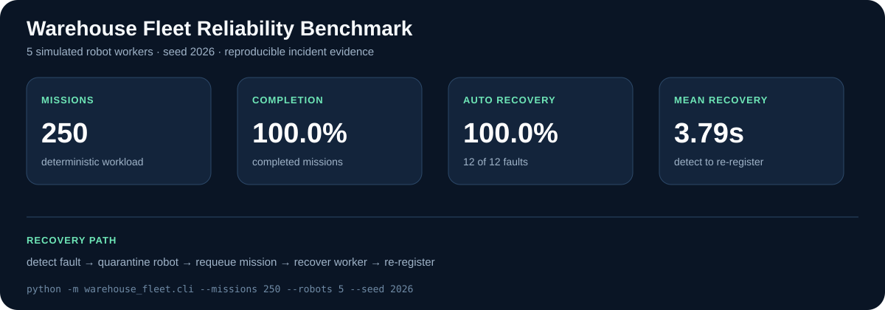

# ROS 2 Warehouse Fleet Reliability Lab

A deterministic reliability and incident-response lab for a simulated warehouse robot fleet. Five workers execute pickup-style missions while a controller tracks health, quarantines failed robots, reassigns interrupted work, and records evidence for operational analysis.



This repository focuses on the work around a robot fleet: mission continuity, telemetry, failure detection, recovery, SQL analysis, dashboards, automated tests, and runbooks. It is designed to be inspectable on any laptop before connecting the same contracts to ROS 2 topics and Nav2 actions.

## Verified benchmark

The checked-in results are produced by this exact command:

```bash
python -m warehouse_fleet.cli --missions 250 --robots 5 --seed 2026
```

See [`results/benchmark_summary.json`](results/benchmark_summary.json) for measured mission completion, injected faults, automatic recovery, mission latency, and mean time to recovery. The SQLite evidence database and Prometheus exposition are generated alongside it. Re-running with the same seed produces the same result.

## Reliability behavior

- capacity-aware mission assignment across a configurable fleet
- health heartbeats, odometry freshness, battery, and mission state
- quarantine before recovery so an unhealthy worker receives no new work
- idempotent mission IDs and bounded retry attempts
- interrupted-mission reassignment to a healthy robot
- automatic recovery and fleet re-registration
- deterministic injection of node crash, stale heartbeat, stale odometry, sensor timeout, localization drop, network delay, low battery, and obstacle timeout
- SQLite evidence store for local execution and PostgreSQL schema for deployment
- operational SQL for completion rate, throughput, per-robot failure rate, MTTR, p95 recovery, unresolved incidents, and downtime
- Prometheus-format fleet and per-robot metrics
- incident runbooks for stale heartbeat, localization failure, and mission timeout

## Quick start

Python 3.11 or newer is the only dependency for the benchmark and tests.

```bash
python -m unittest discover -s tests -v
python -m warehouse_fleet.cli --missions 250 --robots 5 --seed 2026
```

To start the PostgreSQL, Prometheus, and Grafana services:

```bash
docker compose up -d
```

Grafana is available at `http://localhost:3000`, Prometheus at `http://localhost:9090`, and PostgreSQL at `localhost:5432`. The deterministic local runner uses SQLite so reviewers do not need Docker to reproduce the benchmark.

## Evidence map

| Claim | Reproducible evidence |
|---|---|
| missions are retried after a robot failure | `test_fault_quarantines_robot_and_reassigns_mission` |
| recovery time is recorded | `test_incident_records_recovery_time` and `incidents` table |
| operations can be analyzed with SQL | `analytics/operations.sql` |
| metrics are machine-readable | `results/fleet_metrics.prom` |
| results are deterministic | `test_deterministic_benchmark_writes_evidence` |
| incident response is documented | `runbooks/` |

## Repository layout

```text
warehouse_fleet/       controller, state machine, evidence store, metrics, benchmark
tests/                 deterministic recovery and data-integrity tests
analytics/             PostgreSQL operations queries
database/              normalized PostgreSQL schema and indexes
observability/         Prometheus and Grafana provisioning
runbooks/              operator incident-response procedures
docs/                  architecture and ROS 2 integration mapping
results/               generated benchmark evidence
```

## ROS 2 integration

The benchmark does not require ROS 2, but its robot state maps directly to ROS 2 diagnostics, odometry, battery messages, and Nav2 action feedback. [`docs/architecture.md`](docs/architecture.md) documents the adapter boundary so a Gazebo, Isaac Sim, or physical robot can replace each deterministic worker without changing the incident model or analytics schema.

## Scope

All reported numbers are simulator results. This repository does not claim a production warehouse deployment, physical multi-robot fleet, or commercial uptime. Its purpose is to make reliability behavior, data analysis, and operational reasoning concrete and reproducible before hardware deployment.
