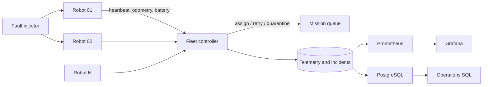

# Architecture and ROS 2 integration seam

The checked-in benchmark is deliberately runnable without a ROS 2 installation. Its state machine models the fleet controller boundary and preserves deterministic incident evidence. A physical or simulated ROS 2 adapter maps the same contracts as follows:

| Fleet field | ROS 2 source |
|---|---|
| heartbeat | `/robot_id/diagnostics` or lifecycle state |
| pose freshness | timestamp on `/robot_id/odom` |
| battery | `sensor_msgs/msg/BatteryState` |
| mission state | Nav2 action feedback/result |
| localization confidence | covariance on pose estimate |
| emergency state | safety controller diagnostic |

The project does not claim a physical warehouse deployment. Results in `results/` come from the deterministic simulator, and the README labels them accordingly.
